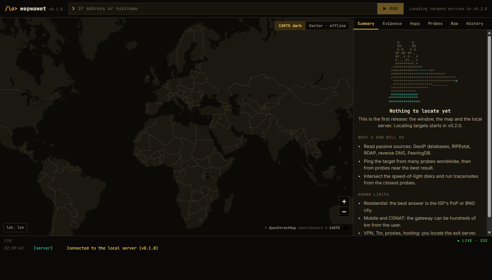

# Wepwawet

[](https://github.com/n36l3c7/Wepwawet/actions/workflows/ci.yml)
[](https://github.com/n36l3c7/Wepwawet/releases)
[](LICENSE)

Measurement-based IP geolocation for Linux: passive evidence plus ping and traceroute from many vantage points, on a map.

**Documentation: <https://n36l3c7.github.io/Wepwawet/>**



> **Status: v0.1.0, first release.** This version ships the application itself: the desktop window, the
> map, the local server, the command line and the Linux packages. Locating targets starts in v0.2.0; see
> [Roadmap](#roadmap).

## What it does

Wepwawet estimates where an IP address is by combining two kinds of evidence:

- **Passive evidence**: GeoIP databases (and how much they disagree), RIR registration data (RDAP),
  routing data (RIPEstat), reverse DNS of the target and of its neighbours, PeeringDB facilities.
- **Active measurements**: ping and traceroute from many probes around the world (Globalping, RIPE Atlas,
  this machine, your own servers). Round-trip times give hard physical limits on where the target can be.

Every estimate comes with an uncertainty radius, a confidence score and the evidence behind it, shown on
the map. It is for network engineers, SOC analysts and researchers who need to know where an address
really is on the network (city, PoP, facility), not who uses it.

## Ethical use

- Wepwawet uses only public data sources and measurement platforms, within their terms of service.
- It never scans ports or interacts with the target beyond what the measurement platforms do (ping,
  traceroute) and DNS lookups.
- Its goal is the network location of an address. The realistic limit for a home connection is the
  provider's point of presence; the subscriber's address is only in the provider's records, which this
  tool does not try to obtain. Do not use it to locate or follow people.

## Requirements

- Linux on **x86_64** or **arm64**. Tested distributions: Debian 13, Ubuntu 22.04 and 24.04, Kali Rolling,
  Fedora 43, Arch Linux.
- On **arm64**, glibc 2.39 or newer (Ubuntu 24.04+, Debian 13+), required by Qt.
- About 190 MB to download and 515 MB of disk space. The packages include their own Python 3.12 and Qt
  WebEngine, so they do not depend on the system Python.
- A graphical session (X11 or Wayland) for the window. Without one, use `wepwawet serve` and a browser.

## Installation

Download the package for your distribution from the
[releases page](https://github.com/n36l3c7/Wepwawet/releases), then:

```sh
# Debian, Ubuntu, Kali
sudo apt install ./wepwawet_0.1.0-1_amd64.deb

# Fedora
sudo dnf install ./wepwawet-0.1.0-1.x86_64.rpm

# Arch Linux
sudo pacman -U wepwawet-0.1.0-1-x86_64.pkg.tar.zst

# Any distribution: AppImage (needs libfuse2, or run it with --appimage-extract-and-run)
chmod +x Wepwawet-0.1.0-x86_64.AppImage
./Wepwawet-0.1.0-x86_64.AppImage
```

The packages install the system libraries Qt needs and recommend `mtr` and `traceroute` for measurements
from this machine. The AppImage expects the same libraries on the host; the list is in the
[installation guide](https://n36l3c7.github.io/Wepwawet/installation.html).

## Quickstart

```sh
wepwawet            # open the application window (also in the desktop menu)
wepwawet doctor     # check the window, the configuration and the traceroute tools
wepwawet --version
```

`wpw` is a short alias of `wepwawet`.

## Command line

| Command | What it does |
|---|---|
| `wepwawet` | Open the window. Same as `wepwawet gui`. |
| `wepwawet gui --browser` | Open the interface in the system browser instead of a window, for machines where Qt WebEngine cannot run. |
| `wepwawet serve [--host H] [--port P]` | Start only the local server and print the address to open. |
| `wepwawet doctor` | Check Python, configuration, directories, the window and the local traceroute tools. |
| `wepwawet version` / `--version` | Show the version. |

## Configuration

Wepwawet works without configuration. To change a setting, create `~/.config/wepwawet/config.toml`:

```toml
[server]
host = "127.0.0.1"   # loopback only, unless allow_remote = true
port = 0             # 0 picks a free port at start-up
allow_remote = false

[map]
basemap = "carto"    # "carto" (online, CARTO dark) or "offline" (bundled Natural Earth outlines)

[cache]
default_ttl_seconds = 86400
ttl_seconds = { rdap = 604800 }   # per-source overrides

[logging]
level = "INFO"       # DEBUG, INFO, WARNING, ERROR
```

| Environment variable | Overrides |
|---|---|
| `WEPWAWET_CONFIG` | Path of the configuration file |
| `WEPWAWET_HOST`, `WEPWAWET_PORT` | `server.host`, `server.port` |
| `WEPWAWET_BASEMAP` | `map.basemap` |
| `WEPWAWET_LOG_LEVEL` | `logging.level` |

Files: configuration in `~/.config/wepwawet/`, history and logs in `~/.local/share/wepwawet/`, the cache in
`~/.cache/wepwawet/` (the `XDG_*` variables are honoured). Secrets are never written to the log.

The online base map uses [CARTO](https://carto.com/basemaps) tiles built from OpenStreetMap data, under
CARTO's terms. Switch to the offline map (button on the map, or `basemap = "offline"`) to make no tile
requests at all.

## Known limits

- **Residential**: the realistic ceiling is the city of the provider's PoP or BNG.
- **Mobile and CGNAT**: the gateway can be hundreds of kilometres from the user.
- **VPN, Tor, proxies, hosting**: the result is the exit server.
- **Anycast**: there is no single location; Wepwawet flags it instead of guessing.
- MPLS tunnels, ICMP filtering and asymmetric routing reduce precision.

## Roadmap

| Version | Content |
|---|---|
| 0.1.0 | Application, map, local server, CLI, Linux packages |
| 0.2.0 | Passive enrichment: GeoIP, RIPEstat, RDAP, reverse DNS, PeeringDB, Shodan, Censys |
| 0.3.0 | Measurement providers, two-stage ping campaign, multilateration, anycast detection |
| 0.4.0 | Traceroutes, location hints from router names, IXPs, path convergence |
| 0.5.0 | Evidence fusion and confidence, history and diff, export, bulk mode |
| 1.0.0 | Accuracy benchmark, hardening, complete documentation |

## Development

Requirements: Python 3.12 with [uv](https://docs.astral.sh/uv/), Node.js 22.

```sh
git clone https://github.com/n36l3c7/Wepwawet.git && cd Wepwawet
uv sync --extra gui                       # Python environment with the desktop window
(cd frontend && npm ci && npm run build)  # interface, built into src/wepwawet/web/dist
uv run wepwawet                           # open the window from the source tree
```

For interface work, run `uv run wepwawet serve --port 8650` and `npm run dev` in `frontend/`, then open the
`/auth?token=...` address printed by `serve` on the Vite port (5173).

Checks (CI runs the same):

```sh
uv run ruff check . && uv run ruff format --check . && uv run mypy && uv run pytest
cd frontend && npm run lint && npm run format:check && npm test
```

Linux packages: `npm run build`, `uv build --wheel`, then `bash packaging/linux/build.sh` on Linux, or
`bash packaging/linux/build-in-container.sh` anywhere Docker or Podman runs. `packaging/linux/test-install.sh`
installs a package in a clean container and opens the window under Xvfb.

See [CONTRIBUTING.md](CONTRIBUTING.md) for the workflow and [SECURITY.md](SECURITY.md) to report a
vulnerability.

## Licence

[MIT](LICENSE). The packages bundle third-party software under its own licences: CPython (PSF), Qt and
PySide6 (LGPLv3), MapLibre GL JS (BSD-3-Clause), Natural Earth data (public domain), Inter and JetBrains
Mono fonts (OFL-1.1).
